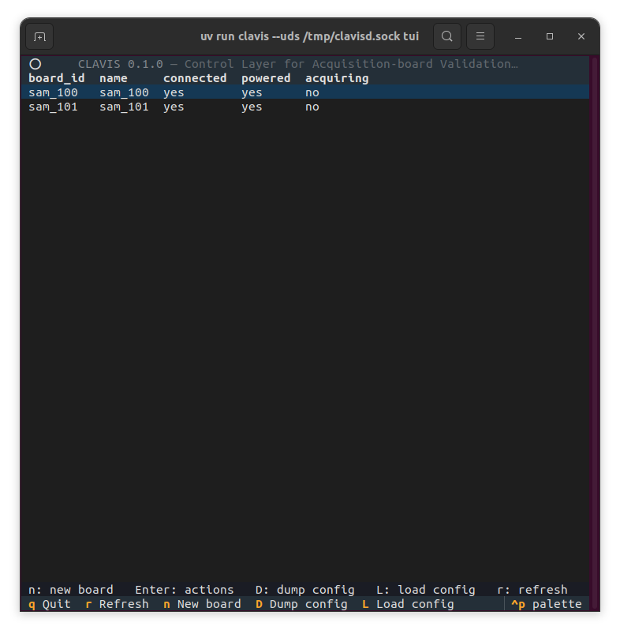
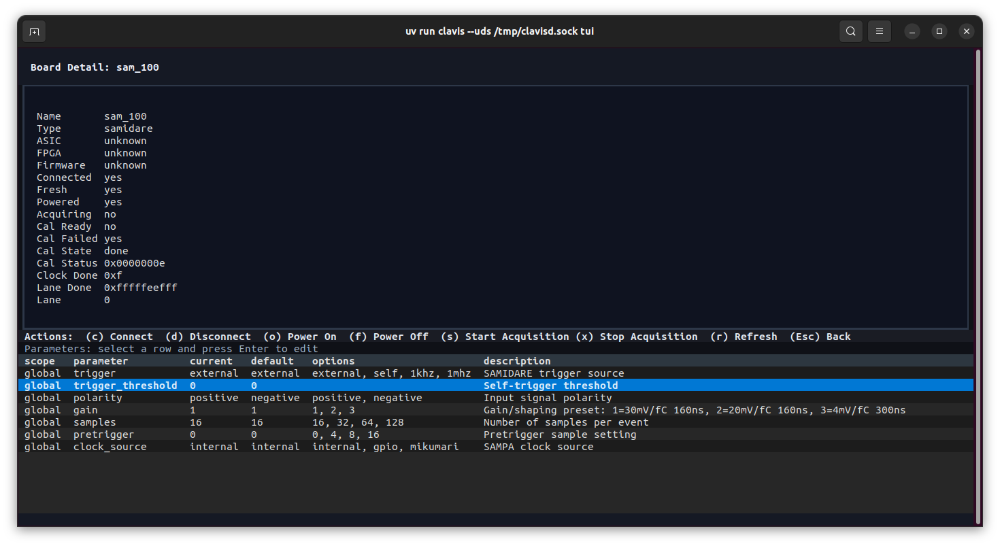

# Getting started

## Install for development

```bash
pipx install uv
uv sync --extra test
```

Install a local board plugin into the same environment when needed:

```bash
uv pip install -e ../clavis-samidare
```

## Start the daemon

Managed installations use `/run/clavis/clavisd.sock`. For an unprivileged
development session, put the socket in a writable temporary directory and
tell both commands to use it:

```bash
export CLAVIS_UDS=/tmp/clavisd.sock
uv run clavisd --uds /tmp/clavisd.sock
uv run clavis status
```

`clavisd` does not listen on TCP. Use Caddy or another Unix-socket-capable
reverse proxy when network access is required. Clavis does not provide
authentication, so expose that proxy only on a trusted network or configure
authentication at the proxy.

## Common commands

```bash
uv run clavis status
uv run clavis boards types
uv run clavis boards list
uv run clavis boards create board_type=TYPE board_id=ID name=NAME
uv run clavis boards connect ID
uv run clavis boards power-on ID
uv run clavis boards start-acquisition ID
uv run clavis boards stop-acquisition ID
uv run clavis boards power-off ID
uv run clavis boards disconnect ID
```

Pass `--host http://HOST:PORT` to use a remote Caddy endpoint. Every command
supports `--help`.

## Terminal interface

Start the keyboard-driven terminal interface with:

```bash
uv run clavis tui
```

The dashboard shows the connection, power, and acquisition state of every
configured board. Its footer lists the available keyboard shortcuts.



Select a board and press <kbd>Enter</kbd> to open its detail view. From there,
you can run board actions and inspect or edit its parameters.


