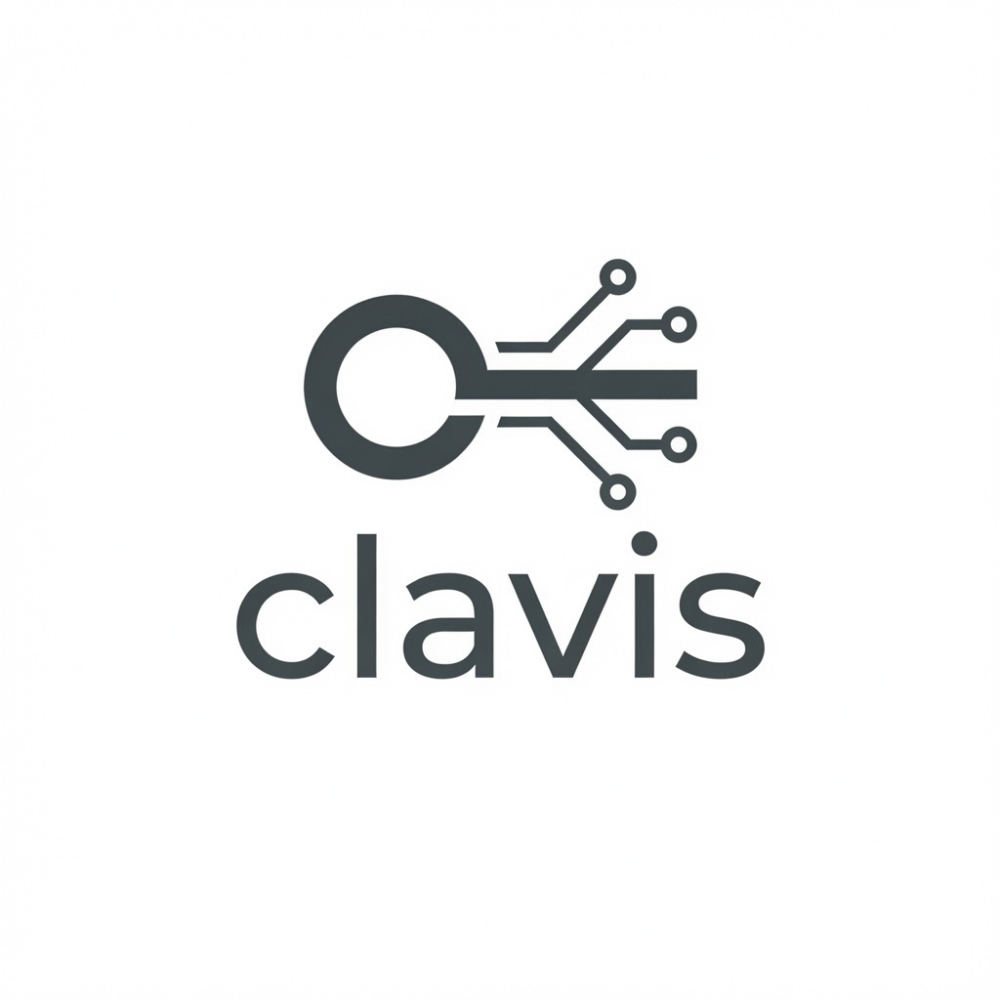

<div class="clavis-hero" markdown>

{ width="360" }

# Acquisition-board control, without board lock-in

Clavis is a Python daemon and terminal client for controlling acquisition
boards through a REST API. Hardware support lives in independently installable
plugins, keeping the daemon and client interfaces reusable across boards.

[Get started](getting-started.md){ .clavis-button }
[Explore the architecture](architecture.md){ .clavis-button .clavis-button-secondary }

</div>

## One daemon, multiple interfaces

`clavisd` owns board state and exposes the API. The command-line client and
keyboard-driven TUI use that same API rather than accessing hardware objects
directly. Local commands use a Unix socket by default; Caddy can provide a
controlled network boundary when remote access is needed.

```text
CLI / TUI -> Unix socket -> clavisd -> board plugin -> protocol client -> hardware
```

## Plugin-based board support

Board packages register through the `clavis.boards` Python entry-point group.
Plugins own their configuration model, register semantics, parameter
definitions, and hardware lifecycle, while core Clavis provides discovery,
validation, reusable transports, API endpoints, and clients.

The first external plugin is
[clavis-samidare](https://github.com/claus-92/clavis-samidare).

## Quick start

```bash
pipx install uv
uv sync --extra test
export CLAVIS_UDS=/tmp/clavisd.sock
uv run clavisd --uds /tmp/clavisd.sock
```

In another terminal:

```bash
uv run clavis status
uv run clavis boards types
uv run clavis tui
```

See [Getting started](getting-started.md) for development and plugin setup.

!!! warning
    Clavis does not provide API authentication. Expose its network proxy only
    on a trusted interface or configure authentication at the proxy.
